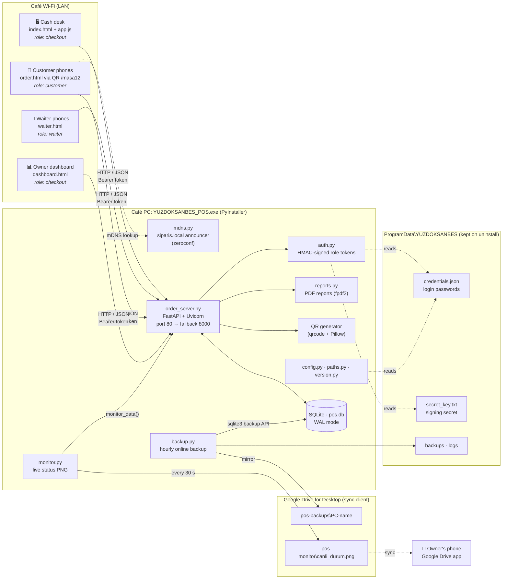
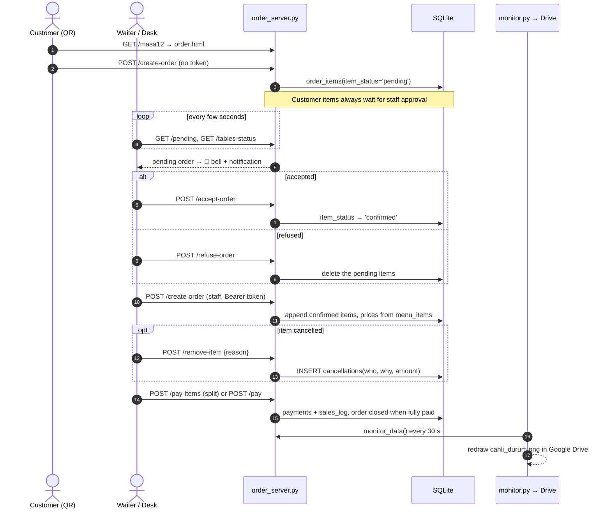
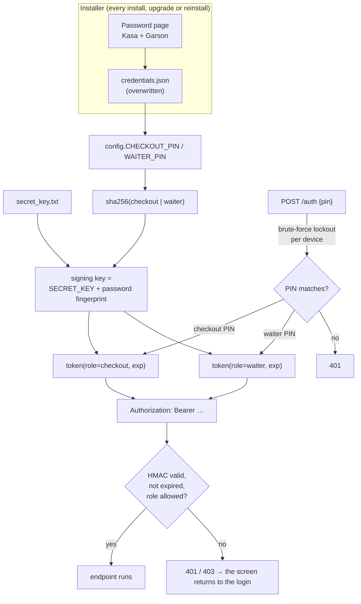
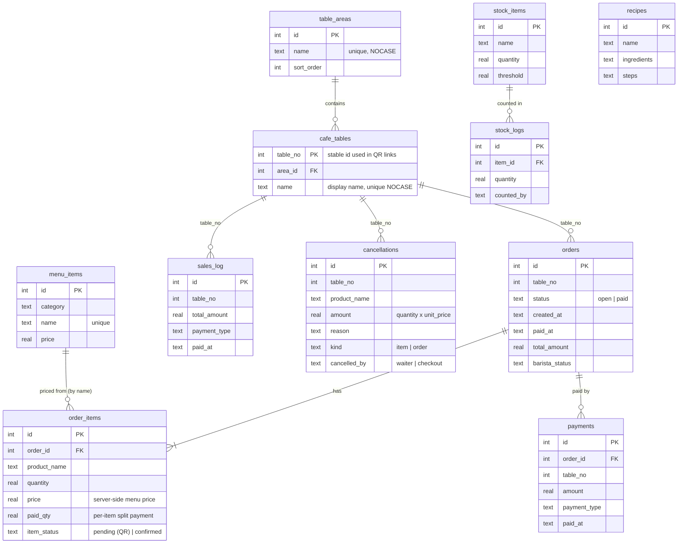
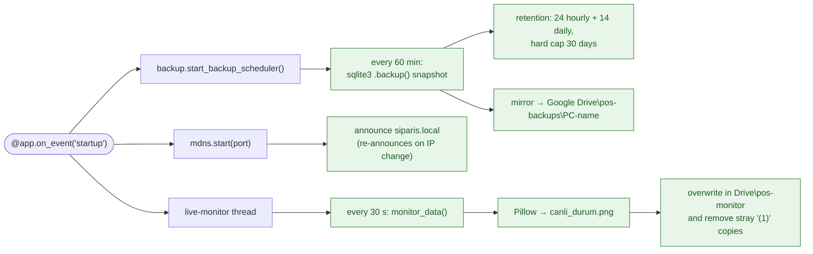
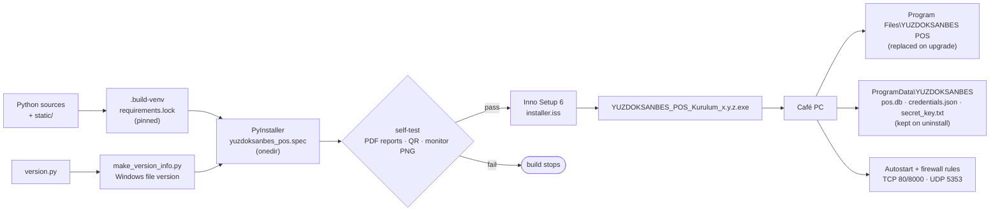

<div align="center">


# YUZDOKSANBES POS

**A self-hosted point-of-sale and café management system that runs on one Windows PC and serves every phone, tablet and QR menu on the café Wi-Fi.**


</div>

---

## Contents

- [Overview](#overview)
- [Features](#features)
- [Architecture](#architecture)
  - [System overview](#system-overview)
  - [Order lifecycle](#order-lifecycle)
  - [Authentication and roles](#authentication-and-roles)
  - [Data model](#data-model)
  - [Background services](#background-services)
  - [Build and deployment pipeline](#build-and-deployment-pipeline)
- [Project structure](#project-structure)
- [Getting started](#getting-started)
- [Configuration](#configuration)
- [API reference](#api-reference)
- [Security](#security)
- [License](#license)

---

## Overview

YUZDOKSANBES POS replaces a paper order pad and a cash-register spreadsheet with a single local web server:

- **Cash desk (Kasa):** takes orders, splits bills, takes payments and cancels items, with a reason.
- **Waiters:** use their own phones, with order-taking rights only.
- **Customers:** scan a QR code on their table and order from the menu. The order waits at the desk until staff accept it.
- **Owner dashboard (Panel):** sales, costs, stock, recipes, coffee-machine upkeep, tasks and PDF reports.
- **Owner's phone:** a live status picture is uploaded to Google Drive every 30 seconds, so the owner can watch the café from anywhere without opening a port to the internet.

Everything runs offline on the café LAN. There is no cloud backend, subscription or external database.

## Features

| Area | Highlights |
|---|---|
| **Orders** | Table grid by area, open bills, partial (per-item) payment, item removal with a cancellation reason, open-duration timers |
| **QR ordering** | Per-table QR codes (`/masa{n}`), orders arrive as *pending* with a bell and a desktop notification until staff accept or refuse them |
| **Tables** | Areas (Bahçe, Salon, …), numeric **or named** tables ("Toplantı Masası"), renaming without breaking printed QR codes |
| **Menu and recipes** | Menu sections and items edited live, recipe cards for the bar |
| **Finance** | Revenue, expenses and manual income by category, daily, monthly and date-range **PDF reports** |
| **Stock** | Item counts, low-stock thresholds, count history |
| **Coffee machine** | Shot counter, maintenance log and service reminders |
| **Cancellations** | Every cancelled item is logged with who, when, why and how much |
| **Live monitor** | `canli_durum.png` is redrawn every 30 seconds into Google Drive: open tables, totals and today's cancellations |
| **Resilience** | SQLite WAL, hourly online backups with rolling retention, mirrored to Google Drive |
| **Zero-config networking** | Announced as **`http://siparis.local`** over mDNS, so QR codes survive DHCP IP changes |
| **Installer** | One-click Windows installer (Inno Setup) that sets the passwords at every install, upgrades in place and keeps the data |

---

## Architecture

### System overview



**Design principles**

- **One process, one file database.** A FastAPI app and SQLite in WAL mode are enough for a café: many tablets read and write at the same time without "database is locked" errors, and there is no database server to install.
- **The server is the source of truth.** The client never sends a price. Totals are recomputed from the menu on the server, so the price cannot be tampered with in the browser.
- **The front end is static.** `static/` is plain HTML and JS. Menus, tables and names are built from `GET /config`, so no HTML is rendered inside Python.
- **Infrastructure never crashes the POS.** Backups, mDNS and the live monitor run on daemon threads. Any failure is logged and skipped, and the till keeps working.
- **Code and data are separated.** The code lives in `Program Files` (read-only) and the data in `%ProgramData%\YUZDOKSANBES`, so upgrades and uninstalls never touch sales history.

### Order lifecycle



### Authentication and roles



| Role | Who | Can |
|---|---|---|
| `customer` | QR menu, no token | Place orders, which arrive as *pending* only |
| `waiter` | Staff phones | Create or accept orders, set preparation status and remove a line with a reason. No payments, whole-bill cancellations or revenue |
| `checkout` | Cash desk, owner | Everything: payments, cancellations, reports, menu, tables, finance, stock and settings |

Changing either password changes the signing key, so **every existing session is invalidated at once**. Open screens show *"Oturum sona erdi"* and return to the login.

### Data model



Other tables include `expenses`, `manual_income`, `tasks`, `coffee_maintenance` and `app_settings`. The schema migrates itself in `init_db()` on every start. Each change is idempotent `ALTER TABLE … ADD COLUMN` or `CREATE INDEX IF NOT EXISTS`, so upgrading never needs a manual migration step.

### Background services



All three run as daemon threads and catch and log their own errors. A missing Google Drive, a blocked mDNS port or a full disk never stop the till.

### Build and deployment pipeline



`build.bat` runs the whole pipeline. See [`yuzdoksanbes_setup/README_KURULUM.md`](yuzdoksanbes_setup/README_KURULUM.md) for the installation guide, written in Turkish for café staff.

---

## Project structure

```
.
├── order_server.py          # FastAPI app: API, DB schema/migrations, startup
├── auth.py                  # role tokens (HMAC-SHA256), role guards
├── config.py                # all tunables: ports, PINs source, backups, monitor
├── paths.py                 # dev vs frozen-exe paths, ProgramData data dir
├── backup.py                # online SQLite backups + retention + Drive mirror
├── monitor.py               # live status PNG for the owner's phone
├── mdns.py                  # siparis.local announcer (zeroconf)
├── reports.py               # daily / monthly / range PDF reports (fpdf2)
├── version.py               # single source of truth for the version
├── static/
│   ├── index.html · app.js · style.css   # cash desk (POS)
│   ├── waiter.html                       # waiter phones
│   ├── order.html                        # customer QR menu
│   ├── dashboard.html                    # owner dashboard
│   ├── cancel_dialog.js                  # shared cancel-with-reason dialog
│   ├── duration.js                       # open-time formatting, table names
│   └── order_alerts.js                   # pending-order bell + notifications
├── yuzdoksanbes_setup/
│   ├── build.bat                # one-command release build
│   ├── yuzdoksanbes_pos.spec    # PyInstaller recipe
│   ├── installer.iss            # Inno Setup script (password page, upgrades)
│   ├── make_version_info.py     # embeds version into the exe
│   ├── requirements.lock        # fully pinned build dependencies
│   └── README_KURULUM.md        # installation guide (Turkish)
├── start.bat · install.bat · set_credentials.bat · create_shortcut.bat
└── requirements.txt
```

---

## Getting started

### Production (café PC)

1. Download or build `YUZDOKSANBES_POS_Kurulum_x.y.z.exe`.
2. Run it and choose the **Kasa** (desk) and **Garson** (waiter) passwords on the password page.
3. The POS starts automatically. Phones on the same Wi-Fi open **`http://siparis.local`**.

### Development

```bash
python -m venv .venv
.venv\Scripts\activate
pip install -r requirements.txt
set_credentials.bat            # sets POS_CHECKOUT_PIN / POS_WAITER_PIN for your user
python order_server.py         # http://localhost (falls back to :8000 if port 80 is busy)
```

### Release build

```bat
yuzdoksanbes_setup\build.bat
:: → yuzdoksanbes_setup\output\YUZDOKSANBES_POS_Kurulum_<version>.exe
```

The build fails if the frozen exe's self-test (PDF reports, QR code, monitor PNG) does not pass.

---

## Configuration

All settings live in [`config.py`](config.py). The most useful ones:

| Setting | Default | Purpose |
|---|---|---|
| `PORT` / `FALLBACK_PORT` | `80` / `8000` | HTTP port. The fallback is used when 80 is busy |
| `MDNS_ENABLED`, `MDNS_NAME` | `True`, `siparis` | LAN name `siparis.local` |
| `BACKUP_EVERY_MIN` | `60` | Backup interval |
| `BACKUP_KEEP_HOURLY` / `_DAILY` | `24` / `14` | Rolling retention |
| `MONITOR_ENABLED`, `MONITOR_EVERY_SEC` | `True`, `30` | Live status picture |
| `AUTH_MAX_FAILS`, `AUTH_WINDOW_SEC` | `5`, `300` | Login brute-force lockout |

Environment overrides: `POS_DATA_DIR`, `POS_CHECKOUT_PIN`, `POS_WAITER_PIN`, `POS_SECRET_KEY`, `POS_BACKUP_MIRRORS`, `POS_MONITOR_DIR`.

---

## API reference

All endpoints return JSON unless noted. 🔒 = staff token required, 👑 = `checkout` only.

<details>
<summary><b>Auth and configuration</b></summary>

| Method | Path | Notes |
|---|---|---|
| POST | `/auth` | `{pin}` → `{role, token}` |
| GET | `/config` | Menu, areas, tables and table names |
| GET | `/health` | Version, port, URL, mDNS state |

</details>

<details>
<summary><b>Orders and payments</b></summary>

| Method | Path | Notes |
|---|---|---|
| POST | `/create-order` | Customer orders → *pending*, staff orders → open bill |
| GET | `/table/{table_no}` | Bill, name and label |
| GET | `/tables-status` 🔒 | Which tables are open |
| GET | `/pending` 🔒 | QR orders waiting for approval |
| POST | `/accept-order` · `/refuse-order` 🔒 | Act on a pending order |
| POST | `/update-order-status` 🔒 | Preparation status |
| POST | `/remove-item` 🔒 | Remove one line, with a reason |
| POST | `/cancel-order` 👑 | Cancel a whole bill, with a reason |
| POST | `/pay` · `/pay-items` 👑 | Full or per-item payment |
| GET | `/sales` · `/sales-summary` 👑 | Sales feed |
| DELETE | `/sales-log/{id}` 👑 | Correct a sale |
| GET | `/cancellations` 👑 | Cancellation log |

</details>

<details>
<summary><b>Tables and menu</b></summary>

| Method | Path | Notes |
|---|---|---|
| GET | `/tables/all` 👑 | `{no, name, label, open}` |
| POST | `/tables/add` · `/tables/rename` · `/tables/delete` 👑 | Numbers (`16-20, 25`) or names |
| POST | `/tables/area-add` · `/area-rename` · `/area-delete` 👑 | Areas |
| GET | `/menu/all` 👑 | Full menu |
| POST | `/menu/add-item` · `/update-item` · `/delete-item` 👑 | Items |
| POST | `/menu/rename-section` · `/delete-section` 👑 | Sections |

</details>

<details>
<summary><b>Back office</b></summary>

| Method | Path | Notes |
|---|---|---|
| GET | `/dashboard/summary` 👑 | KPI tiles |
| GET/POST | `/finance/*` 👑 | Categories, summary, expenses, income |
| GET/POST | `/stock/*` 👑 | Items, counts, thresholds, logs |
| GET/POST | `/recipes/*` 👑 | Recipe cards |
| GET/POST | `/coffee/*` 👑 | Coffee-machine status and maintenance |
| GET/POST | `/tasks/*` 👑 | Staff to-do list |
| GET | `/reports/daily` · `/monthly` · `/range` 👑 | PDF downloads |
| GET | `/qr` · `/qr-codes` 👑 | Printable QR sheet |

</details>

<details>
<summary><b>Pages</b></summary>

`/` (POS) · `/waiter` / `/garson` · `/dashboard` · `/order` · `/masa{n}` (customer QR landing)

</details>

---

## Security

- **No secrets in git.** Passwords come from `credentials.json` (written by the installer), then from environment variables. The signing key is generated per PC into `secret_key.txt`. All runtime data is listed in `.gitignore`.
- **Signed role tokens** use HMAC-SHA256 over the role and expiry. The key includes a fingerprint of the current passwords, so a password change logs everyone out.
- **Brute-force protection:** repeated wrong PINs from one device lock that device out for a time window.
- **Prices are computed on the server.** Client-sent totals are ignored.
- **Customers have the least privilege:** QR orders cannot reach the bill directly until staff accept them.
- **Input validation** uses Pydantic v2 models on every write endpoint.

---

## License

[MIT](LICENSE) © 2026 Hikmet Emre GÜLER
